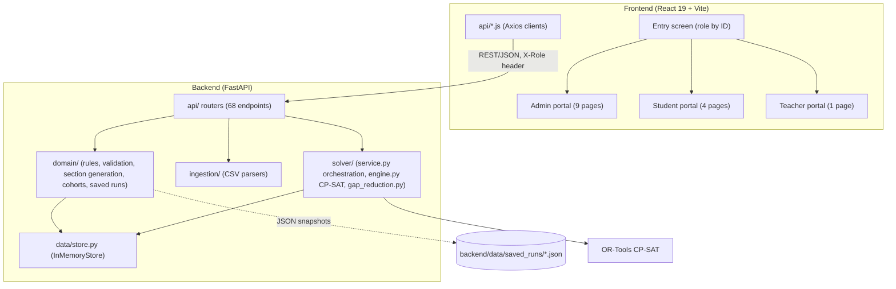
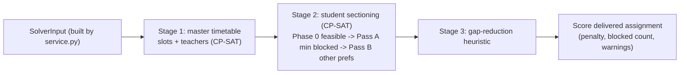
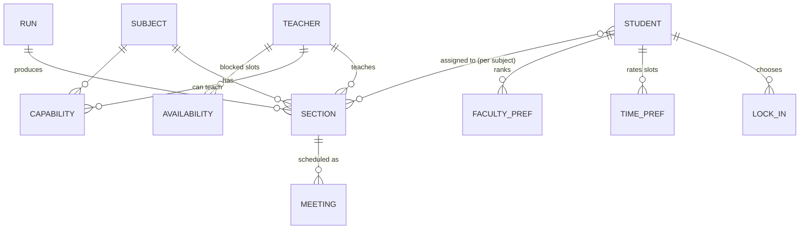
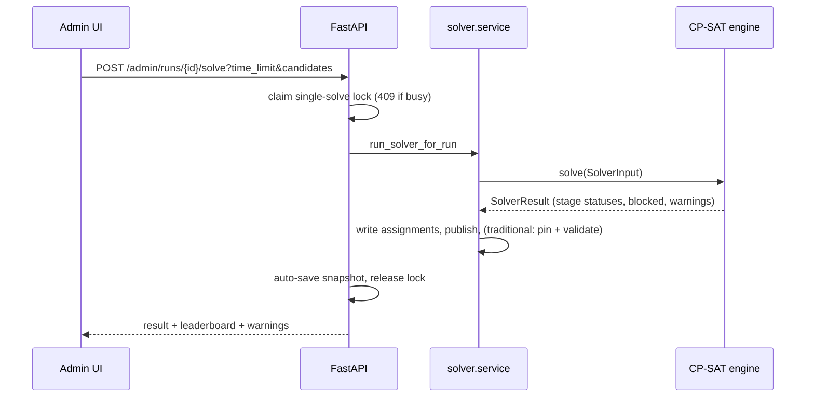
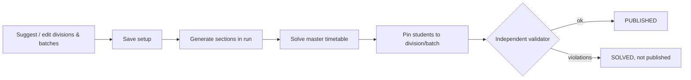

# PWSSAP — Master Context File for Documentation

> **Purpose.** This file is the single source of truth for anyone (human or AI) writing documents about
> PWSSAP: B.Tech project report / blackbook, posters, competition PPTs, abstracts, demo scripts, viva prep.
> Every fact below was checked against the code, a test run, or git history on **2026-10-18**
> (branch `final-review`, 73 commits). Where something is a *recommendation* or *unknown*, it is labelled.

---

## 0. Read this first (rules for the AI using this file)

1. **Do not invent facts.** If a document needs something not in this file (institution name, guide name,
   team roles, academic year, hardware specs, user-study results, deployment details), **leave a visible
   placeholder like `[TO BE FILLED: guide name]`** and list it in your reply. Section 22 lists known gaps.
2. **Use the numbers in Section 14 exactly**, with their conditions. They are measured, machine-specific,
   and some vary run to run (CP-SAT under a time limit). Never round a number *up* in a flattering direction.
3. **Respect Section 21 ("Claims you can and cannot make").** In particular: the solver is *constraint
   programming (CP-SAT)*, **not machine learning**; there is **no real authentication**; data is
   **in-memory** (a backend restart wipes it); the app has **not** been deployed or user-tested.
4. **Terminology.** "Blocked slot" = a student's hard-sounding "never schedule me here" token, which is
   implemented as a *minimised soft* constraint (Section 7.4). Do not describe it as an absolute guarantee.
5. **Privacy.** The demo CSVs contain what look like **real student and faculty names** (and the HOD's name).
   They are deliberately git-ignored. For posters, PPTs and the report: **anonymise or blur names** in
   screenshots, or generate synthetic data. Do not paste real names/roll numbers into public material.
6. The project has **two scheduling modes** (Preference-Weighted = the core product; Traditional
   Division & Batch = an optional alternative). Always say which one you are describing.
7. When in doubt, quote Section 1's one-liners and Section 14's numbers, and cite the section here.

---

## 1. Project identity and one-liners

| Item | Value |
|---|---|
| Name | **PWSSAP** |
| Expansion | **P**reference-**W**eighted **S**tudent-**S**ection **A**llocation **P**rototype |
| README title | "PWSSAP — Department Timetable Generation System" |
| Type | Full-stack web application (React frontend + FastAPI backend + OR-Tools CP-SAT optimiser) |
| Scope | **One department** per running instance (no department/branch field anywhere by design) |
| Semesters supported | 3–8 (odd: 3,5,7; even: 4,6,8). The demo uses Semesters 4 and 6 together |
| Repo | `pwssap-prototype/` (branch `final-review`), 73 commits, 2026-04-24 → 2026-10-18 (bulk 2026-09-02 → 10-18) |
| Git authors seen | `Pranav Waghmare` (63 commits), `Sujal Jakakure` (10). *Team roster/roles: [TO BE FILLED]* |
| License note in README | "Internal Department Prototype — Academic Year 2026–27" |

**One-line pitch.** *PWSSAP automatically generates a whole department's weekly timetable and assigns every
student to a section, while honouring teacher availability as a hard rule and each student's time and
faculty preferences as far as mathematically possible.*

**Two-line pitch.** *A constraint-programming engine (Google OR-Tools CP-SAT) builds clash-free master
timetables for all semesters at once, then places 466 students into sections so that students' blocked and
disliked time slots are minimised — with proofs and transparent diagnostics when a perfect answer is
impossible. Students, teachers and admins each get a purpose-built portal.*

**Problem it addresses (suggested framing — adapt to your institution's story).** Department timetabling
is usually done by hand or with tools that ignore individual student preferences, especially when electives
split cohorts into many parallel sections. PWSSAP treats *timetable construction* and *student sectioning*
as one optimisation problem and exposes the trade-offs to the admin.

---

## 2. Objectives, scope and non-goals

### Objectives (what the system actually does)
1. Ingest department data from CSV (subjects, teachers + capabilities + load caps, students, elective choices).
2. Let students lock in electives, rate time slots, and rank faculty.
3. Let admins mark teacher unavailability (hard constraint).
4. Automatically generate sections, then solve for **slots + teachers + student placement** under hard and soft rules.
5. Publish the timetable; provide student, teacher and admin views; allow post-publication touch-ups.
6. Report solver quality honestly (stage statuses, blocked-slot counts with proof status, warnings).
7. Save, compare and re-activate solved runs (including Traditional vs Preference-Weighted).
8. Optionally build a classical **division / lab-batch** timetable instead (Traditional mode) and independently validate it.

### Non-goals / out of scope (state these explicitly in documents)
- Semesters 1–2 (first year) — "intentionally out of scope" per code comments.
- Multi-department / multi-institution, rooms/venues, exam timetabling.
- Real authentication/authorisation, persistence to a database, deployment/hosting, notifications.
- Any machine-learning component.

---

## 3. Glossary (use these terms consistently)

| Term | Meaning in PWSSAP |
|---|---|
| **Slot** | One 2-hour block in the weekly grid, key `Day-N` (e.g. `Tue-3`) |
| **Meeting** | One weekly occurrence of a section: 2 h (a whole slot) or a 1 h "remainder" (first or second hour of a slot) |
| **Section** | A concrete class group: subject + label + teacher + capacity + meetings. Labels: theory `CODE-T{n}`, lab `CODE-L{n}` |
| **Run** | One solver cycle over a set of semesters; status `draft → solved → published` |
| **Master timetable** | The slot + teacher assignment of all sections (Stage 1 output) |
| **Student sectioning** | Choosing, for each student and subject, which parallel section they attend (Stage 2) |
| **Choice-based tag** | A subject tag whose subtags are electives (e.g. `MDM`, `PE`); each student locks in one subtag per tag |
| **Subtag** | An elective track value (e.g. `AIML`, `CSEC`, `BI`, `IE`). Shared subjects use `AIML|DS` syntax |
| **Lock-in** | A student's recorded choice of subtag per choice-based tag; defines which subjects they are enrolled in |
| **Preferred / Tolerable / Disliked / Blocked** | Time ratings 1 / 2 / 3 / 4. Unrated = Indifferent |
| **Blocked quota** | Max blocked slots per student: `max(1, ⌊(19 − N)/4⌋)`, N = enrolled subjects |
| **Pass A / Pass B** | Stage 2's two optimisation passes: minimise blocked placements first, then everything else |
| **Candidate** | One master-timetable attempt (different random seed) in the multi-candidate search |
| **Division / Batch** | Traditional mode: a fixed class (Div-A) and a fixed lab subgroup (A1, A2…) |
| **Track elective** | Traditional mode: a choice tag with ≥2 subtags and ≥1 lab (e.g. Sem 6 PE) |
| **Dispersal elective** | Traditional mode: a choice tag with ≥2 subtags, all theory (e.g. Sem 4 MDM) — sections run simultaneously |
| **Pin** | Traditional mode: a student fixed to their division/batch sections |

---

## 4. Technology stack (verified)

| Layer | Technology | Notes |
|---|---|---|
| Backend language | Python (tested on **3.12.13**; also ran on 3.14 per local bytecode) | |
| Web framework | **FastAPI** (`>=0.115`), **Uvicorn** (`>=0.30`), **Pydantic** v2 (`>=2.8`), `python-multipart` | Auto docs at `/docs` |
| Optimiser | **Google OR-Tools CP-SAT** (installed 9.15.6755; `requirements: >=9.10`) | Exact CP/SAT solver, `num_workers=0` (all cores), seeded |
| Testing | `pytest >=8`, `httpx` (FastAPI TestClient) | |
| Unused dep | `pandas>=2.2` is in `requirements.txt` but **not imported anywhere** | Don't claim pandas is used |
| Frontend | **React 19.2**, **Vite 8**, **Axios 1.15** | Plain inline-style CSS + small `index.css`/`App.css`; **no UI library, no TypeScript, no Redux** |
| Frontend tooling | ESLint 10 (+ react-hooks, react-refresh plugins) | |
| Storage | **In-memory Python store** (`InMemoryStore`) + JSON files for saved runs | Restart wipes the store |
| Dev proxy | Vite proxies `/admin /health /semesters /students /subjects /teachers /timeslots` → `localhost:8000`; `allowedHosts` includes `.trycloudflare.com` (used for tunnelled demos) | `VITE_API_URL` env overrides the API base (default `http://localhost:8000`) |

**Size (approximate, for "project scale" statements):** backend source ≈ **8.5k lines** (api 2.8k, domain 2.7k,
solver 2.1k, data 0.6k, ingestion 0.4k); helper scripts ≈ 0.9k; tests ≈ **5.5k lines**; frontend ≈ **12.3k lines**
(JS/JSX/CSS). Largest files: `solver/engine.py` (~1.5k), `AdminSolver.jsx` (~1.5k).

---

## 5. Architecture

### 5.1 Layering



Design principles stated in the code: persistence-agnostic domain dataclasses; `engine.py` is store-agnostic
(testable in isolation); `service.py` is the only store-aware solver layer; `api/` is thin HTTP framing;
the store is the one place a future database would plug in (`get_store()`).

### 5.2 Roles and "authentication" (honest description)
- Login screen accepts **`admin`**, a **student roll number**, or a **teacher ID**. No password.
- The frontend sends `X-Role: admin|student|teacher`; the backend only enforces `X-Role: admin` (or `?role=admin`)
  on admin routes via `require_admin`. Student/teacher endpoints take the roll number / teacher ID in the URL and
  are **not protected** (any caller can read or edit any student's preferences).
- CORS is `allow_origins=["*"]`. Treat the whole thing as a **local prototype**.

### 5.3 State and persistence
- `InMemoryStore` holds: subjects, teachers + capabilities + per-subject weekly load caps, teacher availability,
  students, elective selections, student time/faculty preferences, sections, runs, student→section assignments
  (**global**: one live timetable at a time), cached solve results, cohort configs, traditional plans.
- The store is **not** generally thread-safe; only the **single-solve lock** is (Section 7.9).
- **Saved runs** (JSON in `backend/data/saved_runs/`, git-ignored): a snapshot is **auto-saved after every solve**,
  can be re-labelled/saved explicitly, listed, compared, activated (restores sections, assignments, diagnostics,
  and the traditional plan) and deleted. An `active_run.json` pointer restores the active run after a restart —
  but **the student/teacher/subject data itself is not restored**, so re-seed data first.

### 5.4 Run lifecycle

```mermaid
stateDiagram-v2
  [*] --> DRAFT: POST /admin/cycle/initialize
  DRAFT --> DRAFT: generate-sections (clears old sections, assignments, other runs' sections)
  DRAFT --> PUBLISHED: solve = OPTIMAL or FEASIBLE
  DRAFT --> DRAFT: solve = INFEASIBLE / UNKNOWN / cancelled (nothing published)
  PUBLISHED --> PUBLISHED: admin touch-ups
  PUBLISHED --> DRAFT: regenerate sections
  PUBLISHED --> SOLVED: traditional run that fails validation
```


Details: unsolved (draft) runs **hide** placeholder teachers/slots in admin summary and teacher timetable;
section IDs are never reused; only **one** solve/feasibility check may run at a time (HTTP 409); cancel stops
the CP-SAT search in ≈2 s and publishes nothing.

---

## 6. Domain rules

### 6.1 The weekly grid (fixed for every run)
- Monday–Friday × 4 two-hour slots = **20 slots**:

| Slot | Time |
|---|---|
| 1 | 09:00–11:00 |
| 2 | 11:15–13:15 |
| 3 | 13:45–15:45 |
| 4 | 15:45–17:45 |

- `Mon-1` is reserved: **no theory, no lab**. → **19 usable slots**.
- Slot 4 (any day) is **lab-only**, so theory can use slots 1–3 on each day except `Mon-1`.
  - **Verified arithmetic:** theory-legal slots = (5 days × 3 slots) − `Mon-1` = **14**; usable by labs = (5 × 4) − `Mon-1` = **19**.
  - *(An earlier project brief said "15 theory-legal"; the code gives 14. Use 14.)*
- 1-hour remainder meetings occupy the **first or second hour** of a slot (`slot_part` 1 or 2); two remainders may share one slot if they use different halves and don't clash.

### 6.2 Subjects
- Fields: code, name, **tag**, optional **subtag**, semester, **type** (`theory`/`lab`), weekly hours, capacity, optional `slot_structure`.
- **Meeting split rule** (`parse_slot_structure`): default = as many 2 h blocks as fit, plus a 1 h remainder if odd
  (3 h → `[2,1]`, 4 h → `[2,2]`, 1 h → `[1]`). Explicit forms: `"3"`, `"4"`, `"2+1"`, `"1+2"`, `"2+2"`; the sum must equal weekly hours.
- **Section count** (Preference-Weighted mode): `ceil(enrolled / capacity)` for both theory and lab (min 1) — this is the
  *capacity invariant*: seats ≥ enrolled students. Example: PCIT05P (cap 20, 242 students) → 13 lab sections.
- **Shared subtags:** `subtag` may be `AIML|DS` (pipe-separated) to mean a subject serves several tracks.

### 6.3 Electives
- Admin marks which tags are **choice-based** (default: any tag with subtags except `CORE`).
- A student's **enrolled subjects** = all subjects of their semester whose tag is *not* choice-based, plus choice-based
  subjects whose subtag matches the student's lock-in for that tag.
- Lock-in must pick exactly one valid subtag per applicable choice tag. Changing it **clears** the student's time and
  faculty preferences (the enrolled subjects changed). Preferences cannot be saved until lock-in is complete.
- Admin can bulk-import allocations (CSV), auto-lock-in pending students randomly (`/admin/cycle/auto-lock-in`), or override individually.

### 6.4 Student time preferences
- Ratable slots = the 19 usable slots. Ratings: **1 Preferred, 2 Tolerable, 3 Disliked, 4 Blocked**; unrated = Indifferent
  (treated like preferred by the solver, i.e. no penalty).
- **Dynamic blocked quota:** `max_allowed_blocks = max(1, ⌊(19 − N)/4⌋)` where N = number of enrolled subjects
  (falls back to N = 14 if unknown). Demo: Sem 6 students (N = 10) → **2**; Sem 4 students (N = 12) → **1**.
  Enforced in `domain/validation.py`, `api/preferences.py` **and** the UI (`StudentPrefs.jsx`): at quota, the next click skips
  Blocked and goes to Indifferent, with an inline warning.
- Validation: reject if **> 70 %** of ratable slots are blocked; reject if over quota; **warn** if ≥ 80 % of rated slots are
  Disliked/Blocked; **warn** if ≥ 5 slots rated all identically; reject unknown slot keys / invalid values / empty submission.

### 6.5 Faculty preferences (secondary, soft)
- Ratings 1–3 only (**no Blocked**). Only subjects with **≥ 2 eligible teachers** are rankable. Optional; partial is fine.
- Solver penalties: Preferred 0, Tolerable 1, Disliked 2 (weight 1) — always weaker than time preferences (weight 5).

### 6.6 Teacher data
- CSV: `teacher_id, teacher_name, subject_1, subject_1_load, subject_2, subject_2_load, …`. Each (subject, load) pair declares
  a **hard weekly-hours cap** for that teacher on that subject. Subject codes must exist in the catalog.
- **Availability** is a hard constraint: admin toggles blocked slots per teacher (grid UI with bulk actions).

---

## 7. The solver (the technical heart)

### 7.1 Pipeline



- **`service.py`** gathers sections, preferences, availability, load caps, enrolments; runs pre-checks that produce warnings
  (no capable teacher, not enough seats, insufficient declared teacher hours); calls `solve()`; on OPTIMAL/FEASIBLE writes
  assignments back and sets the run PUBLISHED; auto-saves a snapshot.
- **Time budget (single candidate):** Stage 1 gets `min(0.7 × limit, 45 s)`; Stage 2 gets what remains.
- Stage 1 essentially **always uses its full slice** (it returns FEASIBLE, not proven OPTIMAL, on the full dataset).

### 7.2 Stage 1 — master timetable (variables and constraints)
**Variables:** for every section meeting, a Boolean per candidate slot (2 h) or per (slot, half) (1 h); for every section, a Boolean per capable teacher.

**Hard constraints**
| ID | Rule |
|---|---|
| 1.a | **Teacher availability** — a teacher is never in a slot the admin blocked |
| 1.b | **Teacher no-clash** — checked per (slot, half-hour part) |
| 1.c | **Meeting non-repetition & spacing** — one section can't repeat in a slot; multi-meeting *theory* sections: ≤ 1 meeting per day; multi-meeting *lab* sections: no back-to-back slots on a day |
| 1.d | **Teacher-subject weekly load caps** from the teacher CSV |
| 1.e | **Single-section subjects sharing students can't overlap** |
| 1.f | **Division / batch non-overlap** (label-regex driven: `-T(\d+)$` division theory, `-L(\d+)$` batch lab): core theories in a division don't overlap; labs in a batch don't overlap; a batch's labs don't overlap its parent division's theory; elective-track synchronisation by subtag |
| type rules | Theory never in slot 4; nothing in Mon-1 (via candidate-slot lists) |

**Soft (objective):** cohort-aggregated student preference per section-slot (`2 × avg penalty + 300 × (# students who blocked that slot)`), and **teacher load balance** (`10 × (max − min sections taught)`).
> The 300-per-blocked-student term is "Layer 2" of the 3-layer blocked-slot design (Section 7.4).

### 7.3 Stage 2 — student sectioning
**Variables:** `z[student, subject, section] ∈ {0,1}`; **exactly one** section per (student, subject).
**Hard:** section capacity; **student no-clash** (per slot-part); (Traditional mode: pinned memberships).
**Phase 0** finds any valid assignment (guaranteed fallback).
**Pass A:** minimise **only** the number of blocked placements → gives a (often proven) minimum.
**Pass B:** add `blocked ≤ Pass-A optimum` and minimise everything else.

**Penalty weights (Pass B / reporting)**
| Item | Points |
|---|---|
| Time rating Preferred / Indifferent | 0 |
| Tolerable | `5 × 1 = 5` |
| Disliked | `5 × 3 = 15` |
| **Blocked** | `5 × 400 = 2,000` per meeting |
| Faculty Tolerable / Disliked | 1 / 2 |
| Section size balance | `2 × |students − ideal|` per parallel section (ideal = ⌊total/sections⌋) |

The **reported penalty is recomputed from the delivered assignment** (after gap reduction), never read from a solver that may not have produced it.

### 7.4 The blocked-slot design (key design narrative for the report)
*Original wish:* "Blocked" should be **hard**, like teacher availability. *Reality:* with hundreds of students each
blocking something, a hard rule is infeasible (shown on real data: one 56-student elective's blocks together covered all
14 theory-legal slots). *Resolution — a three-layer defence:*
1. **Layer 1 — Dynamic quota** limits blocks per student (formula in 6.4), enforced in validation, API and UI.
2. **Layer 2 — Stage 1 steering:** `+300 × blocked_count` penalty when a section sits in slots its cohort blocked.
3. **Layer 3 — Stage 2 lexicographic minimisation:** Pass A minimises blocked placements first; Pass B can never trade them away.
Where the minimum is non-zero, the UI says so and states whether it is **proven minimal for that master timetable**
(only a different master timetable can lower it → multi-candidate search).

### 7.5 Multi-candidate search (portfolio)
Used when candidates ≥ 2 (UI presets 1, 3, 5, 10; backend cap 10):
- **Phase 1 (≈ 60 % of the budget):** for each seed (42, 101, 202, …) build a master timetable (Stage 1, ≤ 45 s) and **score** it with a quick Pass A.
- **Phase 2 (the rest):** fully optimise (Pass A + B) **only the best-scoring** candidate (fewest blocked placements).
- Early stop if a candidate has **0 blocked placements proven**. A candidate can be reported `INFEASIBLE` (Stage 2 proved no valid student assignment exists for that timetable) — a real reason to try several.
- Non-winning candidates show `SCORED` with **no penalty** (never a fake 0); their score is an upper bound (UI shows "≤ N").
- Time limit is a **shared total**, not per candidate.

### 7.6 Stage 3 — gap reduction
Heuristic post-pass that moves/swaps students between **parallel sections of the same subject** to compress daily schedules
(idle slot gaps), subject to: zero clashes, capacity, **never** moving a student into a Blocked or Disliked slot, no worsening of preferences.
Reported as e.g. "eliminated N idle slot gap(s) across M student(s)".

### 7.7 Status semantics (important for honest reporting)
- `stage1_status`, `stage2_status`, and overall `status`. **Overall `OPTIMAL` only if both stages are proven optimal.**
- On the full demo dataset Stage 1 is `FEASIBLE`, so overall is usually **`FEASIBLE`** — that is expected, not a failure.
- `INFEASIBLE`/`UNKNOWN` → nothing is published; warnings explain (e.g. time budget too short).
- Feasibility-only mode (hard constraints only, no publish) is available in the UI ("Check Feasibility First").

### 7.8 Other solver facts
- **Gap-reduction & diagnostics** appear as human-readable warnings in the Admin UI (blocked-slot examples, proven-minimum note, candidate summary).
- **Cancellation:** a watcher thread calls `stop_search()`; measured ≈ **2.2 s** to stop, nothing published, lock released.
- **Determinism:** seeded, but results under a *time limit* are not bit-identical run to run.
- **Model size (measured on an earlier 217-section dataset):** order of **~31k** Boolean variables (Stage 1) and **~42k** (Stage 2). Current dataset has 199 sections / 5,144 enrolments; sizes are similar in magnitude. *Re-measure before quoting exact counts.*
- ⚠ **Stale docstring:** the top of `solver/engine.py` still says blocked slots are "hard-forbidden". The actual behaviour is Section 7.4. Do not quote that docstring.

### 7.9 Concurrency & safety
One solve at a time (`409`); `GET /admin/runs/solve/status` lets a reloaded UI reattach and show "a solve is already running"; cancel button; no partial publish.

---

## 8. Traditional Division & Batch mode (optional second mode)

**Idea.** Instead of free student sectioning, fix **divisions** (Div-A, Div-B…, theory is per division) and **lab batches**
(A1…A4, labs are per batch). It reuses the same solver for the master timetable, then **pins students** to their division/batch and
**independently validates** the result. Preference-weighted mode is unaffected for runs not generated in traditional mode.

### 8.1 Flow (Admin → *Classes & Batches*)
1. For each semester of the run: **Suggested divisions** (balanced by roll number, ~60 per division; inside each track for track electives) — edit by moving students, rebalancing, adding/removing divisions, choosing **2–6 lab batches** per division.
2. **Save setup** (validated: every student placed exactly once, batch counts in range, etc.).
3. **Save & generate sections** for the active run (needs saved setup for every semester in the run).
4. Open **Solver** and Run. After a successful solve the pins are applied and validated.
5. Status & validation: `GET /admin/cohorts/status`, `GET /admin/cohorts/validation`.

### 8.2 Elective classification (by catalog *shape*, not names)
| Shape | Behaviour | Demo example |
|---|---|---|
| Choice tag, ≥ 2 subtags, ≥ 1 lab → **track** | Students grouped by locked-in track; divisions stay inside one track | Sem 6 `PE` (AIML 124 / CSEC 100) |
| Choice tag, ≥ 2 subtags, all theory → **dispersal** | One section per subject, **all at identical times**, clear of core classes | Sem 4 `MDM` (BI 56, IE 54, BD 67, RB 65) |
| Choice tag with one offering | In-class like core | — |
| Non-choice (incl. labs like `MDM03`, `OEC14`) | In-class: theory per division, labs per batch | `MDM03` (Sem 6), `OEC14` (Sem 4) |

### 8.3 Guarantees and the independent validator
`domain/traditional_validation.py` re-derives guarantees from the final store and reports violations by kind:
unscheduled, illegal_slot, teacher_unassigned, teacher_clash, teacher_unavailable, division_theory_clash, batch_lab_clash,
batch_division_clash, dispersal_not_synchronised, missing_section, pins_overridden, split_unit. If anything fails, the run stays **SOLVED (not PUBLISHED)**.

### 8.4 Engine touch points (all additive, inert for other runs)
`SolverInput.batch_division_map` (explicit batch→division), `SolverInput.sync_section_groups` (dispersal synchronisation), `SolverInput.pinned_student_sections`, plus two hook calls in `solver/service.py`; covered by `tests/test_engine_traditional_hooks.py`.

### 8.5 Trade-off to state honestly
Because students are pinned and preferences are ignored in allocation, traditional mode yields **many more blocked-slot placements** (215 in the measured run) than preference-weighted mode (12 in its measured run) — in exchange for **fixed classes and a fully validated, clash-free structure**. This contrast is the story of the *saved-runs comparison matrix*.

---

## 9. Data formats (CSV) and the demo dataset

### 9.1 Subjects CSV (`subjects.csv`)
Required: `subject_code, subject_name, subject_tag, semester, type, weekly_hours, capacity`. Optional: `subtag`, `slot_structure`.
Aliases: `name→subject_name`, `tag→subject_tag`, `hours→weekly_hours`, `linked_pattern→slot_structure`. **All-or-nothing**: any row error rejects the whole file with row-level messages. Duplicate codes rejected.

### 9.2 Teachers CSV (`teachers.csv`)
`teacher_id, teacher_name, subject_1, subject_1_load, subject_2, subject_2_load, …` (ragged rows allowed; blank cells skipped). A code without a load (or vice-versa) is an error; loads must be positive integers; unknown subject codes rejected; subjects must be imported first.

### 9.3 Students CSV (`students.csv`)
Required: `roll_number, name, semester` (header whitespace stripped; duplicates rejected). The UI offers a CSV template download (`students_template.csv`).

### 9.4 Elective allocations CSV (`sem4_electives.csv`, `sem6_electives.csv`)
`roll_number`, optional `student_name`, plus **one column per choice tag** (e.g. `MDM`, `PE`) with the subtag value. Lines starting with `#` are ignored; subtag matching is case-insensitive; per-row errors are returned. A template can be generated from the server (`/admin/cycle/elective-template/{semester}`).

### 9.5 The official demo dataset (`demo_run/`, **git-ignored — share it with teammates separately**)
Files: `subjects.csv`, `teachers.csv`, `students.csv`, `sem4_electives.csv`, `sem6_electives.csv`.

| Quantity | Value |
|---|---|
| Subjects | **29** (Sem 4: 15 = 9 theory + 6 lab, 40 weekly hrs; Sem 6: 14 = 6 theory + 8 lab, 30 weekly hrs) |
| Teachers | **21**; **82** teacher–subject capability pairs; 2–5 subjects per teacher |
| Students | **466** (Sem 4: 242; Sem 6: 224) |
| Enrolled subjects per student | Sem 4: **12**; Sem 6: **10** |
| Total student-course enrolments | **5,144** |
| Sem 4 MDM lock-ins | BI 56, IE 54, BD 67, RB 65 |
| Sem 6 PE lock-ins | AIML 124, CSEC 100 |
| Standard sections generated | **199** (150 lab + 49 theory), 235 meetings |
| Blocked-slot quota in demo | Sem 6 → 2, Sem 4 → 1 |

Sem 4 subjects: BSC07 (3 h), PCIT05/06/07/52 theory+lab pairs (PCIT52P is 1 h), `OEC14` (lab, tag `OE`), `VSEC03` (4 h lab), MDM dispersal group `MDMBI02/IE02/BD02/RB02` (4 h theory each).
Sem 6 subjects: PCIT13T/P, PCIT14T/P, PCIT16P (4 h lab), PE track subjects `PEIT25T/P, PEIT29T/P` (AIML) and `PEIT28T/P, PEIT32T/P` (CSEC), and `MDM03` (a **lab**, tag `MDC_OE`).
> History note: the dataset changed over time (earlier docs mention 31 subjects / 217 sections). **Use the numbers in this table.**
> Quirk: `students.csv` contains a roll number with a trailing space (`24101A0002 `); the parser strips it.

### 9.6 Seeded stress-test assumptions (used by the benchmark scripts, not by the product)
Faculty admin blocks: HOD `T001` Thursday all day + Tue-4; `T002` Wed-3/Wed-4; `T008` Fri-3/Fri-4 (**9** blocked slots).
Student preference profiles are *synthetic*, ("stacked, opinionated" — 2,849 Preferred, 3,158 Disliked, 690 Blocked tokens in the latest seeding), deliberately adversarial. Say "synthetic" in documents.

---

## 10. API reference (68 endpoints; 49 admin-only, 19 public)

Base URL `http://localhost:8000`; interactive docs at `/docs`. Admin routes need header `X-Role: admin`.

| Group | Endpoints |
|---|---|
| Meta | `GET /health`, `GET /timeslots`, `GET /semesters` |
| Subjects | `GET /subjects`; admin: `POST /admin/subjects/import`, `DELETE /admin/subjects`, `GET /admin/subjects/tags`, `GET /admin/subjects/choice-groups`, `GET /admin/subjects/{code}/teachers` |
| Teachers | `GET /teachers`; admin: `POST /admin/teachers/import`, `DELETE /admin/teachers`, `GET /admin/teachers/{id}/capabilities`; `GET /teachers/{id}/timetable[.csv]`, `GET /teachers/{id}/sections/{sid}/roster.csv` |
| Availability | admin: `GET/PUT /admin/teachers/{id}/availability` |
| Students | `GET /students`; admin: `POST /admin/students/import`, `DELETE /admin/students`, `GET /admin/students/{roll}/choices`; `GET /students/{roll}/available-choices`, `GET/PUT /students/{roll}/lock-in`, `GET /students/{roll}/enrolled-subjects` |
| Preferences | `GET/PUT /students/{roll}/time-preferences`, `GET/PUT /students/{roll}/faculty-preferences`, `GET /students/{roll}/rankable-subjects`, `GET /students/{roll}/sections` (timetable + satisfaction stats) |
| Cycle | admin: `GET /admin/cycle`, `PUT /admin/cycle/choice-tags`, `POST /admin/cycle/initialize`, `POST /admin/cycle/auto-lock-in`, `GET /admin/cycle/elective-template/{sem}`, `POST /admin/cycle/import-elective-allocations` |
| Runs | admin: `GET/POST /admin/runs`, `GET /admin/runs/{id}`, `PUT /admin/runs/{id}/choice-tags`, `POST /admin/runs/{id}/generate-sections`, `GET /admin/runs/{id}/sections[/{sid}]`, `GET /admin/runs/{id}/summary` |
| Solver | admin: `POST /admin/runs/{id}/solve?time_limit=&candidates=`, `POST /admin/runs/{id}/feasibility`, `POST /admin/runs/{id}/cancel`, `GET /admin/runs/{id}/solve-result`, `GET /admin/runs/solve/status` |
| Saved runs | admin: `GET /admin/runs/saved`, `GET /admin/runs/compare?run_a=&run_b=`, `POST /admin/runs/{id}/save-snapshot`, `POST /admin/runs/saved/{snap}/activate`, `DELETE /admin/runs/saved/{snap}` |
| Touch-ups | admin: `POST /admin/sections/{id}/enroll`, `DELETE /admin/sections/{id}/students/{roll}`, `PUT /admin/sections/{id}/teacher`, `PUT /admin/sections/{id}/capacity` (warn-don't-block semantics: capacity overflow, slot clash, double-booking are warnings) |
| Traditional | admin: `GET /admin/cohorts/detect-clusters`, `GET /admin/cohorts/suggest`, `GET/DELETE /admin/cohorts`, `POST /admin/cohorts/save`, `POST /admin/cohorts/generate-sections`, `GET /admin/cohorts/status`, `GET /admin/cohorts/validation` |

**Typical solve response fields:** `status`, `run_status`, `objective_value`, `wall_time_seconds`, `num_conflicts`, `stage1_status`, `stage2_status`, `blocked_placements`, `blocked_minimum_proven`, `candidates[]`, `warnings[]`, `sections[]`, `student_section_assignments`.

---

## 11. Frontend: pages, features and user flows

### 11.1 Login
Single input: `admin`, a student roll number (e.g. `25101A0001`), or a teacher ID (e.g. `T001`). Role chips (Admin / Student / Teacher) explain the hints. Session persists in `localStorage`.

### 11.2 Admin portal (sidebar order)
| Page | What it does |
|---|---|
| **Dashboard** | 6-step setup checklist with live progress and deep links: 1 Students → 2 Subject catalog, elective choices & allocations → 3 Faculty & capabilities → 4 Faculty availability → 5 Student lock-in / override (expandable breakdown) → 6 Solver. Metric tiles: active semesters, subjects, students, faculty, setup progress |
| **Students** | CSV upload with client-side preview and server-side row-error report; template download; lock-in inspection; **override modal** for a single student's elective choices |
| **Subjects** | Subject CSV import (all-or-nothing), choice-tag configuration, **elective-allocations modal** (bulk CSV upload, also reachable from the Dashboard) |
| **Teachers** | Teacher CSV import with capabilities and load caps; roster view |
| **Availability** | Per-teacher weekly grid; click to toggle blocked slots; quick bulk actions; hard-constraint explanation |
| **Classes & Batches** | Traditional mode setup (Section 8.1), mode/status badges, validation display |
| **Solver** | Preflight checklist; "Generate Sections"; time limit (presets 30 s / 1 m / 5 m / 10 m / 30 m) and candidates (1 / 3 / 5 / 10); **Check Feasibility First**; **Run Solver** with progress bar (a *client-side timer* over one blocking request, not true progress), **Stop**; result card (status, per-stage statuses, penalty, blocked placements, duration, conflicts, sections); candidate **leaderboard**; formatted **warnings**; reattaches to a solve already running; **Saved runs** panel (save/label, activate, delete) and **side-by-side comparison matrix** with takeaway text |
| **Published Timetable** | Tabs: **Weekly Matrix** (5×4 grid; legend theory 2 h / remainder 1 h / lab), **Section List** (filters, rosters), **Teacher Workload**; semester filter; "No timetable yet" state for unsolved runs |
| **Touch-ups** | Post-publication overrides: enrol/unenrol student, reassign teacher, override capacity — with warnings and a session audit log. *(Slot reassignment is **not** offered.)* |
| *Department Solver Cycle* (`admin-runs`) | Secondary page (not in the sidebar) for initialising/synchronising the run |

### 11.3 Student portal
| Page | What it does |
|---|---|
| **Elective Lock-in** | Choose one subtag per choice tag; saving may clear preferences (warned) |
| **Time Preferences** | 19-slot grid; click cycles Indifferent → Preferred ★ → Tolerable ✓ → Disliked ↓ → Blocked ✕; live **blocked-quota** counter; validation warnings |
| **Faculty Preferences** | Rank eligible teachers per rankable subject |
| **My Timetable** | Weekly grid; **satisfaction score** and **cohort average**; breakdown (preferred / tolerable / unrated / disliked / blocked); faculty-match stats; perk badges (e.g. "Free Monday morning"); if a blocked slot was unavoidable, an **apology notice** explaining why (single-section / few parallel sections); **Download Timetable (PDF)** = browser print dialog with A4-landscape print styling and institutional header; **CSV export** |

**Satisfaction score formula:** `(100 × preferred + 85 × (tolerable + unrated) + 35 × disliked) / total meetings`, blocked counts 0 points, clamped 0–100; cohort average computed the same way over classmates.

### 11.4 Teacher portal
**My Timetable & Rosters:** weekly grid, assigned sections with hours, per-section roster table/compact view with search, **printable roster** (print dialog, optional attendance columns), CSV exports (timetable, one roster, all rosters), run selector.

### 11.5 UI facts useful for design/poster text
Colour semantics: Preferred green, Tolerable blue, Disliked amber, Blocked red; Mon-1 shown as restricted, slot 4 as lab-only. Per-role accent colours: Admin blue `#185FA5`, Student purple `#7F77DD`, Teacher green `#1D9E75`.

---

## 12. End-to-end workflows (use for the user manual and demo script)

### 12.1 Admin runbook (Preference-Weighted)
1. Start backend and frontend (Section 19). Open `http://localhost:5173`, enter `admin`.
2. **Students** → upload `students.csv` (466). **Subjects** → upload `subjects.csv` (29), configure choice tags (`MDM`, `PE`), upload `sem4_electives.csv` and `sem6_electives.csv`.
3. **Teachers** → upload `teachers.csv` (21, 82 capabilities). **Availability** → block e.g. HOD's Thursday.
4. *(Students rate time/faculty preferences from their portals — or seed them with the script.)*
5. **Solver** → *Generate Sections* (199) → set e.g. **3 candidates, 300 s** → *Run Solver*. Read the leaderboard and warnings.
6. **Published Timetable** → review grid/sections/workload. **Touch-ups** for manual fixes. **Saved runs** to compare modes.

### 12.2 Student journey
Enter roll number → **Lock-in** (electives) → **Time Preferences** (respect blocked quota) → **Faculty Preferences** → after publication **My Timetable** (score, notices, PDF/CSV).

### 12.3 Teacher journey
Enter teacher ID → **My Timetable & Rosters** → print/export rosters.

### 12.4 Demo script (≈ 5 minutes, recommended)
1. *Problem* (30 s): why sectioning with preferences is hard (cite 466 students, 199 sections).
2. *Data in* (45 s): dashboard progress → CSV upload with error preview.
3. *Student side* (60 s): quota-limited blocked slots; satisfaction score on a published timetable.
4. *Solve* (90 s): run with 3 candidates; narrate leaderboard (scored vs optimised), "proven minimum".
5. *Traditional vs Preference-weighted* (60 s): comparison matrix (Section 14.3).
6. *Close* (15 s): limitations + future work.
> A full solve takes **minutes**. For live demos, pre-solve and **activate a saved run**, or use a short time limit and say so.

---

## 13. How we built it — engineering history (for "Development Process" / "Challenges" chapters)

**Timeline (from git):** initial commit 2026-04-24; Jul–Aug 2026 early backend/frontend split and role model; **2026-09-02/03**
"phase-1…11" backend (data model, subject import/choice tags, students, teachers, availability, student & faculty preferences, section generation, solver with load balancing, overrides, timetable views) then 4 frontend phases;
**2026-09-06/07** "realign" chunks (department-level cycle, subtags, lock-in, 3-hour subjects with 1 h remainders);
**2026-10-14/15** teacher load caps, shared subtags, feasibility-first solver, CP-SAT service, elective CSV import, frontend pages;
**2026-10-16** admin solver/dashboard, **gap reduction**, student-aware master timetable, multi-candidate portfolio, dynamic blocked quota & fail-safe constraints;
**2026-10-17** solver rework (below), concurrency/lifecycle hardening, seeding & probes, satisfaction metrics, back-to-back meeting rule, traditional mode; 
**2026-10-18** saved runs, faculty comparison matrix, active-run persistence.

### 13.1 Technical challenges and how they were solved (each is a strong report/viva story)
| # | Problem found | Evidence | Fix |
|---|---|---|---|
| 1 | **Hard per-student blocking made the whole timetable INFEASIBLE** | One 56-student single-section elective's blocks covered all 14 theory-legal slots | Removed the hard rule; blocked slots became a steered soft objective (Section 7.4) |
| 2 | **Solver reported `OPTIMAL` with penalty `0` while ~300 students were in blocked slots** | Optimiser timed out; fallback solution has no objective; CP-SAT labels it OPTIMAL | Fallback now reported FEASIBLE; penalty recomputed from the delivered assignment |
| 3 | **Blocked slots effectively ignored** (~250–300 placements) | Blocked penalty drowned in one big objective under a short budget | **Lexicographic Pass A / Pass B** → 18–25 placements (milder profile), then 12 (stacked profile, 3 candidates) |
| 4 | **Tolerable ratings silently dropped** | A rating compared against a penalty constant | Fixed; regression test fails if re-introduced |
| 5 | **More candidates made results worse** | Each candidate got 1/N of the budget for the *full* solve | Portfolio redesign: build+score many, fully optimise one |
| 6 | **Concurrent solves and un-cancellable search** | Second click raced the first; Stop didn't stop CP-SAT | One-solve lock (409), status endpoint, `stop_search()` watcher (≈2 s) |
| 7 | **Run lifecycle bugs** | Dangling student assignments, reused section IDs, placeholder data visible | Cleanup on regenerate, monotonic IDs, hidden placeholders for unsolved runs |
| 8 | **Benchmark script didn't match the app** | CLI omitted subtag inputs, so "OPTIMAL in 47 s" didn't reproduce | CLI now calls the same service path as the API |
| 9 | **First Traditional attempt looked finished but wasn't** | Sections invisible to solver; PE sections missing; students re-shuffled by Stage 2; dispersal electives unsynchronised; unequal batch counts mis-mapped; no admin guard | Rebuilt per run with explicit plan, pinning, sync groups, batch map, admin guard, independent validator |
| 10 | **Tests passed while real data failed** | Unit fixtures were invented; no full-dataset test | Added full-department regression tests (opt-in) and mutation-checked regression tests |

**Lessons worth stating:** validate on realistic data; never trust a solver status without recomputing the objective; separate "hard whenever possible" from "minimise the violation"; keep optional modes additive and independently validated.

---

## 14. Results and measurements (quote with conditions)

**Environment for all figures below:** Windows, Python 3.12.13, OR-Tools 9.15.6755, local single machine
(*CPU/RAM not recorded — [TO BE FILLED by the person who runs the final benchmark]*). Date 2026-10-18.
Dataset: Section 9.5. Synthetic student preferences (Section 9.6). Time limits are **totals**.

### 14.1 Preference-Weighted, full department
Command: `python backend/scripts/run_stress_test.py --candidates 3 --time-limit 300`

| Metric | Result |
|---|---|
| Students / sections / enrolments | 466 / 199 / 5,144 |
| Overall / Stage 1 / Stage 2 status | FEASIBLE / FEASIBLE / FEASIBLE |
| Total wall time | **300.8 s** (budget 300 s) |
| Candidates built & scored | 3; quick Pass-A scores **210, 12, 151** blocked → candidate **#2** fully optimised |
| **Blocked-slot placements (delivered)** | **12** of 6,094 student meetings (**0.20 %**), **proven minimum** for the chosen timetable |
| Total penalty | 63,489 |
| Student rating mix (synthetic, adversarial) | 42.8 % unrated/preferred, 28.8 % tolerable, 28.2 % disliked |
| Gap reduction | 4 idle gaps removed across 6 students |

### 14.2 Quality evolution (Preference-Weighted; **different seeding profiles — see caveat**)
| Stage of work | Blocked placements | Note |
|---|---|---|
| Before fixes (soft penalty starved, short budget) | **≈ 250–300** | milder seeding profile; also saw false `OPTIMAL, 0` |
| Even with ~187 s for Stage 2, single candidate | 58 | before lexicographic passes |
| After Pass A/B, 1 candidate, 300 s | 25 (not proven) | milder profile |
| After Pass A/B, 3 candidates, 300 s | 18 (proven min) | milder profile |
| Latest, 3 candidates, 300 s | **12** (proven min) | "stacked" profile |

*Caveat:* the seeding profile changed between rows 1–4 and the last row, so the last row is **not** a like-for-like improvement claim. For an improvement claim use rows 1→4 (same profile).

### 14.3 Traditional mode, full department
Command: `python backend/scripts/run_traditional_probe.py --time-limit 120`

| Metric | Result |
|---|---|
| Divisions | Sem 4: 4 (61, 61, 60, 60 students; 4,4,3,3 batches). Sem 6: 4 (AIML 62, 62; CSEC 50, 50; 4,4,3,3 batches) |
| Sections generated / sync groups / students pinned | 208 / 1 / 466 |
| Status | FEASIBLE (Stage 1) · Stage 2 OPTIMAL · published |
| Wall time | **105.5 s** |
| **Independent validation** | **0 violations** (no division/batch/teacher clashes, dispersal electives synchronised, all 466 placed in saved division/batch) |
| Blocked-slot placements | **215** (preferences are not used for allocation here) |
| Generation warnings | Divisions of 61/62 students vs theory capacity 60; `MDMBD02` 67 and `MDMRB02` 65 vs capacity 60 |

**Comparison takeaway (suitable for a slide):** *Preference-weighted mode placed 12 students' meetings in blocked slots; the classical division/batch plan placed 215 — but the latter is fully fixed-class and independently verified clash-free.* (Different run lengths: 300 s vs 120 s.)

### 14.4 Responsiveness (measured on localhost during earlier full-data runs)
| Check | Result |
|---|---|
| API during a running solve | 180 pings, **0 errors**, median ≈ 0 ms, max ≈ 0.58 s |
| Student timetable lookups (466 students) | ≈ 0–16 ms each |
| Teacher timetables (21) | ≤ 16 ms each |
| Admin summary payload | ≈ 200 KB in < 0.1 s |
| Timetable correctness (earlier probe) | 0 student clashes, 0 teacher overlaps, 466/466 non-empty student timetables |
| UI rendering/lag with all sections | **Not measured in a browser** — don't claim |

### 14.5 Test & build status (2026-10-18)
- Backend: **191 passed, 2 skipped** (the two skips are opt-in slow full-department tests, `RUN_SLOW=1`). Normal run ≈ 10–14 s.
- The two opt-in full-department tests were also run on 2026-10-18 and **both pass** (≈ 187 s together).
- Frontend: `vite build` succeeds (chunk-size warning only); `cohortsLogic.check.mjs` passes; ESLint reports **14 problems in 2 files** (pre-existing style issues such as empty `catch` blocks — be honest if asked).
- Regression tests were **mutation-checked** (re-introducing the Tolerable bug and the hard-block bug makes them fail).

### 14.6 Reproduce everything
```bash
cd backend
venv\Scripts\python.exe scripts\run_stress_test.py --candidates 3 --time-limit 300
venv\Scripts\python.exe scripts\run_traditional_probe.py --time-limit 120
set RUN_SLOW=1 && venv\Scripts\python.exe -m pytest tests\test_full_department_regression.py tests\test_traditional_full_department.py -q
```
CP-SAT under a time limit is **not bit-for-bit repeatable**; expect small variation in blocked counts and penalties.

---

## 15. Testing strategy (for the report)
- **191 automated tests** across: CSV parsers (subjects, teachers, students, electives), validation rules (preferences, quota, faculty), domain (grid), section generation (incl. 3-hour subjects), solver engine (tiny instances: feasibility, availability, load balance, infeasibility), **solver regression** (cohort blocks covering all slots, honest objective, Tolerable counting, Pass A/B behaviour, portfolio selection/early-stop/cancel), gap reduction, API phases 2–11 (HTTP-level via TestClient), run lifecycle (409 guard, hidden placeholders, regeneration cleanup), saved runs, traditional cohorts & engine hooks, and opt-in **full-department** tests (466 students).
- Styles: pytest functions and "check()" scripts that exit non-zero on failure (they fail at collection); script-style files can also be run via `python -m tests.<name>`.
- Helper scripts (not tests): `seed_via_api.py` (loads the demo set through the real REST API), `ui_flow_probe.py` (replays the admin flow and measures latency, clashes, concurrency guard), `run_stress_test.py`, `run_traditional_probe.py`.
- Gap to admit: **no automated browser/UI tests**; UI verified manually and by build/lint.

---

## 16. Design decisions to mention ("product decisions" referenced in code comments, #1–#16)
Department-only scope (#1); odd/even semester split (#2); choice tags per run/cycle (#3); fixed Mon–Fri × 4-slot grid with reserved Mon-1 and lab-only slot 4 (#4); sections linked patterns & parallel labs (#6); teacher CSV capabilities/loads, no preferred slots for teachers (#8); teacher availability = **hard** (#9); student time preference with Blocked (#10); faculty preference secondary & soft, never outweighs time preference (#11); objective priority: time > faculty > load balance (#12); **auto-publish after solving** (#13); lightweight role model, no real auth (#14); timetable views carry full slot details (#15); separation of concerns — generation/solver logic store-agnostic (#16).

---

## 17. Security, privacy and ethics notes
- No authentication; any caller can read/modify student data by roll number; CORS wide open. Intended for a local/department-network prototype only.
- Demo data appear to contain real names → anonymise in public material; `demo_run/` and saved-run JSONs are git-ignored.
- Fairness angle worth a sentence: the blocked quota prevents a few students from dominating the schedule; the satisfaction score and cohort average make outcomes visible; students are told when a blocked slot was unavoidable.

---

## 18. Limitations and known issues (be upfront — judges respect honesty)
1. **In-memory store** — restart loses data (only saved-run JSON survives; people/subject data must be re-imported).
2. **No real auth**; unprotected student/teacher endpoints.
3. **Solve time:** a full-department solve needs minutes (recommend ≥ 180 s single candidate; ≥ 240–300 s for 3 candidates). Short limits give worse results or `UNKNOWN`.
4. **Stage 1 is never proven optimal** on the full dataset; overall status is normally `FEASIBLE`. Results vary run to run.
5. **Blocked slots are minimised, not guaranteed zero**; the system reports the count and whether it is the proven minimum.
6. **Progress bar is a timer**, not real solver progress (single blocking request).
7. **Traditional mode** ignores student preferences in allocation (215 blocked placements measured); some divisions exceed theory capacity (61–62 vs 60) and two elective subjects exceed 60 (generation warnings); minor UI/UX polish items remain.
8. **No room/venue modelling**; no exam scheduling; semesters 1–2 unsupported.
9. **Stale engine docstring** (claims blocked slots are hard-forbidden); `pandas` listed but unused; README previously over-claimed (fixed in the new README).
10. UI performance with many sections **not measured in a browser**; no automated UI tests; ESLint has 14 pre-existing problems.
11. Per-student "faculty rating" check in the objective skips only *Preferred* (penalty 0) — harmless but noted.

### Future work (suggested)
Persistent database + migrations; real authentication (SSO/JWT) and per-role authorisation; real-time solver progress (WebSocket/SSE) and background job queue; rooms/venues and capacity; Stage-1 awareness of student blocks for single-section electives (the main source of the remaining blocked placements); incremental re-solve after small changes; mobile-friendly UI; automated browser tests; deployment (Docker/CI).

---

## 19. Setup and run guide for teammates (Windows paths shown; works similarly elsewhere)

**Prerequisites:** Python 3.11+ (3.12 tested), Node 18+ (Node 26 used here), npm.

```bash
# 1) Backend
cd backend
python -m venv venv
venv\Scripts\activate            # macOS/Linux: source venv/bin/activate
pip install -r requirements.txt
uvicorn main:app --port 8000      # DO NOT use --reload while testing seeded data (a reload wipes memory)

# 2) Frontend (new terminal)
cd frontend
npm install
npm run dev                       # http://localhost:5173

# 3) Load the demo data through the real API (new terminal, from repo root)
backend\venv\Scripts\python.exe backend\scripts\seed_via_api.py
#   needs demo_run/ (git-ignored; get it from the team). Loads subjects, teachers, students, electives,
#   teacher availability, and 100% student preferences. ~20–35 s. Re-runnable (clears first).
```
Then open the app → enter `admin` → **Solver**.

**Pitfalls**
- Python clients: use `127.0.0.1`, not `localhost` (IPv6 resolves first and uvicorn binds IPv4).
- Backend restart ⇒ empty store ⇒ re-run the seeder.
- Time limit is a *total*; use ≥ 180 s (1 candidate) or ≥ 240–300 s (3 candidates) on the full data.
- `demo_run/` and `backend/data/saved_runs/*.json` are git-ignored on purpose.
- Tunnelled demos: Vite `allowedHosts` includes `.trycloudflare.com`; API calls go through the Vite proxy.
- Docs: `http://localhost:8000/docs`.

---

## 20. Repository map

```
pwssap-prototype/
├─ README.md   context.md   pyrightconfig.json   .gitignore
├─ demo_run/                      (git-ignored) sample CSVs
├─ backend/
│  ├─ main.py                     FastAPI app + CORS + router wiring
│  ├─ requirements.txt
│  ├─ api/        availability, cohorts, cycle, deps(require_admin), faculty_preferences, meta,
│  │              overrides, preferences, runs(+saved runs), sections, solver, students, subjects, teachers
│  ├─ domain/     enums, models, timeslots, validation, section_generation,
│  │              cohorts, traditional_plan, traditional_section_generation, traditional_validation, saved_runs
│  ├─ ingestion/  subjects_csv, teachers_csv, students_csv
│  ├─ solver/     engine.py (CP-SAT, ~1.5k lines), service.py (orchestration), gap_reduction.py
│  ├─ data/       store.py (InMemoryStore), saved_runs/ (JSON snapshots, git-ignored)
│  ├─ scripts/    seed_via_api, ui_flow_probe, run_stress_test, run_traditional_probe
│  └─ tests/      ~30 test modules
└─ frontend/
   ├─ vite.config.js (proxy + tunnel hosts)   .env.example (VITE_API_URL)
   └─ src/  App.jsx · constants.js · api/ (catalog, client, cohorts, cycle, overrides, preferences, runs)
            components/ (Sidebar, CycleBanner, RunContextBanner, ui, modals, PrintableRosterModal)
            pages/ (EntryScreen; admin/*, student/*, teacher/*; cohortsLogic.js + check)
```

---

## 21. Claims you CAN and CANNOT make

| ✅ You can say | ❌ Do not say |
|---|---|
| "Uses Google OR-Tools **CP-SAT**, an exact constraint-programming solver" | "AI/ML-powered", "machine learning", "neural" (unless you mean it loosely and say so) |
| "Teacher availability, clashes, capacity, load caps are **hard** constraints" | "Zero blocked slots guaranteed" |
| "Blocked slots are **minimised first**, with a proven minimum reported when available" | "Blocked slots are never violated" |
| "466 students, 29 subjects, 21 teachers, 199 sections solved together" | "Handles any university" / "scales to thousands" (not tested) |
| "12 blocked placements (0.20 %) in the measured run; 215 in the traditional run" | A bare "98 % satisfaction" or other figure not in Section 14 |
| "Independent validator found 0 violations in the Traditional run" | "Production-ready", "deployed", "secure" |
| "Full solve takes minutes; results vary slightly run to run" | "Real-time" scheduling |
| "Saved-run comparison between Traditional and Preference-Weighted" | "User-tested with students/faculty" (no study exists) |
| "191 automated backend tests passing (2 opt-in slow tests skipped)" | "100 % test coverage" (not measured) |

---

## 22. Information the team must supply (placeholders)
Institution & department names; project guide/mentor and HOD names; team members, roll numbers and roles; academic year/semester of submission;
final project title; logo/branding; real-world motivation story; machine specs used for the final benchmark; any user feedback collected;
confirmation of whether demo names/roll numbers may appear publicly; screenshots (Section 24); literature citations (Section 25).

---

## 23. Document-specific guidance

### 23.1 Blackbook / B.Tech report — suggested chapter mapping
| Chapter | Pull from |
|---|---|
| Abstract (≤ 250 words) | §1 pitch, §14.1 & 14.3 headline numbers, §21 safe claims |
| 1 Introduction (motivation, problem, objectives, scope) | §1, §2 |
| 2 Literature survey | §25 (verify citations before use) |
| 3 Requirements & feasibility (functional/non-functional, stack) | §2, §4, §6, §17 |
| 4 System design (architecture, data model, ER/UML, APIs, UI flow) | §5, §6, §10, §11, §20 (diagrams in §24) |
| 5 Algorithm & methodology (formulation, constraints, objective, 3-layer blocked design, portfolio, gap reduction) | §6–§8 |
| 6 Implementation (modules, key code, CSV formats, UI) | §9–§12, §20 |
| 7 Testing (strategy, cases, results) | §14.5, §15 |
| 8 Results & analysis (tables, comparison, evolution) | §14 |
| 9 Challenges & lessons | §13 |
| 10 Limitations & future work | §18 |
| 11 Conclusion | §1, §14, §18 |
| Appendices (CSV samples *(anonymised)*, API list, setup, glossary) | §3, §9, §10, §19 |

### 23.2 Poster (one page) — recommended content blocks
Title + one-liner (§1) · the problem in 3 bullets · architecture diagram (§5.1) · "How it solves": 3-layer blocked-slot idea (§7.4) · **three hero numbers** (466 students solved together; **12 blocked placements (0.20 %), proven minimum**; 0 validator violations in Traditional mode) · screenshot strip (timetable grid, student satisfaction, leaderboard) · limitations/future work in 2 lines · QR to repo/demo. Keep text tight; anonymise screenshots.

### 23.3 Competition PPT — 10–12 slide skeleton
1 Title/team · 2 Problem & pain · 3 Why it's hard (numbers: 466 students, 5,144 enrolments, 199 sections, 19 slots) · 4 Solution overview (two modes) · 5 Architecture · 6 The algorithm (2-stage + lexicographic blocked minimisation + candidates) · 7 Student/teacher/admin experience (screens) · 8 Results (§14.1–14.3 chart: blocked placements before→after, Traditional vs Preference-Weighted) · 9 Engineering rigor (191 tests, validator, regression story) · 10 Limitations & roadmap · 11 Demo/Q&A. Suggested charts: bar (blocked placements across stages 250–300 → 58 → 25 → 18), bar (Traditional 215 vs Preference-weighted 12), pie (rating mix).

### 23.4 Abstract template (fill from this file)
"*PWSSAP is a web-based system that generates a department-wide weekly timetable and allocates students to parallel sections using constraint programming (Google OR-Tools CP-SAT). It treats teacher availability, clash-freedom, capacity and load caps as hard constraints and optimises students' time-slot and faculty preferences, minimising slots students have blocked and reporting proven minima. On a 466-student, 29-subject, 21-teacher dataset it … [use §14 numbers]. An optional Traditional Division & Batch mode builds fixed classes and lab batches and independently validates the result. …*"

### 23.5 Likely viva / Q&A (with grounded answers)
- **Why CP-SAT, not a genetic algorithm?** Exact solver: hard constraints are guaranteed, infeasibility is *proven*, and it reports bounds/proofs (e.g. proven minimum blocked count). (§7)
- **Why two stages?** Building the master timetable and assigning students are coupled but separable; splitting keeps models tractable (~30–40k Booleans each). (§7.1)
- **Why aren't blocked slots hard?** They made the problem infeasible on real data; we use a quota + steering + lexicographic minimisation and disclose the count. (§7.4)
- **How do you know the result is correct?** Hard constraints in the model; an independent validator (traditional); recomputed objective; probes checking clashes; 191 tests incl. full-dataset regression. (§8.3, §15)
- **What if two preferences conflict?** Priority order: time > faculty > load balance; blocked minimised first. (§7.3, §16)
- **What happens if the solver can't finish?** Nothing is published; warnings explain; you can raise the limit, use feasibility check, or cancel (≈2 s). (§7.7, §7.9)
- **Is it scalable?** Tested on one department (466 students); larger scale untested. (§21)
- **Is it secure?** No — prototype auth. (§5.2, §17)
- **Difference between the two modes?** Preference-weighted: students float among parallel sections to match preferences; Traditional: fixed divisions/batches, validated. (§8)
- **What was the hardest bug?** False OPTIMAL/penalty 0 and the infeasible hard-block rule. (§13.1)

---

## 24. Diagrams to include (Mermaid sources ready to render)

**Data model (simplified ER)**


**Solve sequence**


**Traditional flow**


**Screenshot shot-list (anonymise names!):** login; admin dashboard checklist; CSV upload with error preview; availability grid; solver page before/after run (leaderboard + warnings); published weekly matrix; teacher workload tab; student time-preference grid showing quota counter; student timetable with satisfaction score and notice; teacher roster print view; Classes & Batches page; saved-runs comparison matrix.

---

## 25. Suggested reading (verify before citing — not checked against sources here)
University course/exam timetabling literature (e.g. International Timetabling Competition tracks 2007/2011/2019 and their problem descriptions); curriculum-based course timetabling surveys; **student sectioning** and the UniTime system (Müller & Murray); Google OR-Tools CP-SAT documentation (developers.google.com/optimization) and the CP-SAT primer; constraint programming texts (e.g. Rossi, van Beek, Walsh, *Handbook of Constraint Programming*); lexicographic/multi-objective optimisation basics; FastAPI and React 19 official docs.

---

## 26. Quick reference card (copy/paste facts)
- **PWSSAP** = Preference-Weighted Student-Section Allocation Prototype. React 19 + Vite 8 · FastAPI · OR-Tools CP-SAT.
- 20-slot week, **19 usable**, **14 theory-legal**; Mon-1 reserved; slot 4 lab-only.
- Dataset: **466 students · 29 subjects · 21 teachers · 82 capabilities · 5,144 enrolments · 199 standard sections**.
- Blocked quota `max(1, ⌊(19−N)/4⌋)` → Sem 6: 2, Sem 4: 1.
- Hard: teacher availability, teacher & student no-clash, capacity, load caps, slot legality. Soft: student time prefs (blocked = 2,000 pts), faculty prefs, balance.
- Best measured: **12 blocked / 6,094 meetings (0.20 %)**, proven min, 3 candidates, 300 s. Traditional: **0 violations**, 215 blocked, 120 s.
- **68 API endpoints** (49 admin, 19 public) · **191 tests passed, 2 skipped** · ≈ 8.5k backend + 12.3k frontend + 5.5k test lines · 73 commits.
